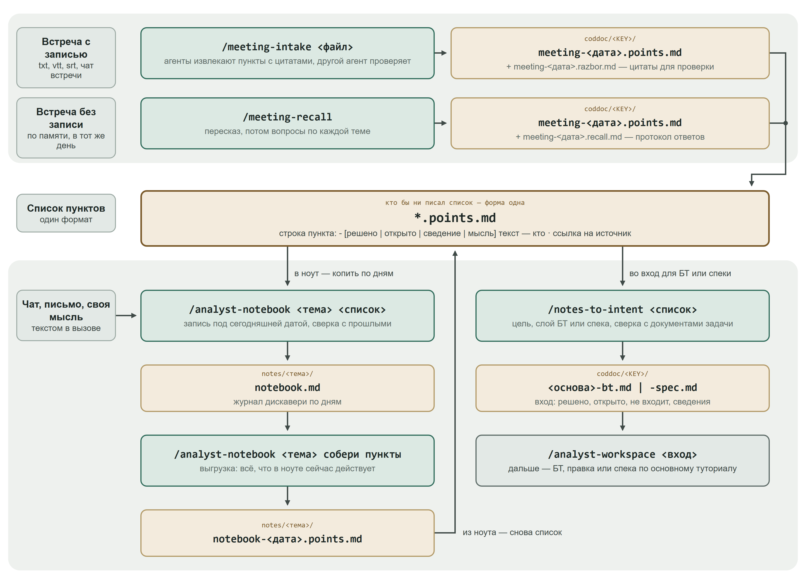

# Петля дискавери: мини-туториал

До БТ идёт дискавери: созвоны, переписка, свои мысли. Четыре скилла собирают это в один формат — список пунктов `*.points.md` — и делают из него вход для БТ или спеки. Всё живёт в том же репозитории **AI-SDD**: ноуты в `notes/`, встречи и входы — в `coddoc/<КЛЮЧ>/`.

## Как это устроено



- **Три источника — один формат.** Расшифровка → `/meeting-intake`, встреча по памяти → `/meeting-recall`, ноут → `/analyst-notebook <тема> собери пункты`. Все трое пишут `*.points.md` одной формы.
- **Список идёт в одно из двух мест:** в ноут — `/analyst-notebook <тема> <список>`, копить по дням; или во вход — `/notes-to-intent <список>`, из него пишется БТ или спека.
- **Из ноута список выгружается тем же форматом**, поэтому `notes-to-intent` принимает его так же, как список встречи.

```
AI-SDD/
├── notes/
│   └── выдача-лодок/                          # один ноут — одна тема
│       ├── notebook.md                        #   журнал по дням
│       ├── sources/                           #   длинные вставки дословно
│       │   └── 2026-10-17-1.md
│       ├── notebook-2026-10-20.points.md      #   выгрузка «собери пункты»
│       └── сводка-для-заказчика-2026-10-20.md #   выкладка «собери …»
└── coddoc/
    ├── SMSEC-12345/                           # ключ есть — всё в папку задачи
    │   ├── meeting-2026-10-16.points.md       #   список из расшифровки
    │   ├── meeting-2026-10-16.razbor.md       #   разбор с цитатами, читает человек
    │   ├── meeting-2026-10-17.recall.md       #   протокол встречи по памяти
    │   ├── meeting-2026-10-17.points.md       #   список из протокола
    │   └── meeting-2026-10-16-bt.md           #   вход для БТ
    └── _inbox/                                # ключа ещё нет
```

## Общие правила

- **Каждый скилл пишет только свои файлы.** Документы задачи не правит, другие скиллы не зовёт. Следующий шаг запускаете вы: в конце отчёта скилл печатает строку «дальше:» с готовой командой.
- **Ключ задачи не обязателен.** Без ключа файлы встреч и входы ложатся в `coddoc/_inbox/`, ноут живёт без ключа.
- **Скилл не добавляет от себя** ни чисел, ни имён, ни сроков. Всё, что в пункте, есть в источнике или в вашем ответе.
- **Вопросы — гипотезой.** Скилл предлагает вариант, вы подтверждаете или поправляете. Сказанное в строке вызова он не переспрашивает. Исключение — `meeting-recall`: о содержании встречи он вариантов не предлагает.
- **Коммит и пуш делаете вы.**

## Пункт: четыре вида

| Вид | Что это | Обязательный хвост |
|---|---|---|
| `[решено]` | договорились; `не входит: …` — вынесли за рамки | `— решил: <кто>` |
| `[открыто]` | обсуждали, не решили; ждём ответа | `— ждёт: <кто>` |
| `[сведение]` | как сейчас, объём, срок, как ведёт себя чужая система | `— со слов <кто>` |
| `[мысль]` | догадка или предложение аналитика — не решение | нет |

```
# Пункты: выдача лодок
> Источник: coddoc/SMSEC-12345/call-2026-10-16.vtt
> Задача: SMSEC-12345
> Встреча: 2026-10-16 11:00–11:40 · участники: заказчик — Лаврова Е.; инструктор — Шубин Д.

- [решено] Лодку выдаёт смотритель причала — решил: Лаврова Е. · L57
- [открыто] Нужна ли клиенту отметка об инструктаже — ждёт: Шубин Д. · L112
- [сведение] Сейчас выдачу записывают в бумажный журнал — со слов Лавровой Е. · L20
```

Ссылка в конце строки — откуда пункт: `L57` — строка расшифровки или протокола, `2026-10-14 №1.2` — пункт ноута (дата, запись 1, пункт 2).

**`[решено]` без того, кто решил, не бывает.** Не видно, кто решил, — пункт ляжет `[открыто]`. Ваше собственное предложение — `[мысль]`, пока его не принял кто-то другой.

## Сценарий 1. Вести ноут: `analyst-notebook`

Ноут — журнал дискавери по одной теме: что узнали, что решили с людьми, что подумали сами.

1. `/analyst-notebook запиши в ноут по выдаче лодок: <текст>`. Текст — кусок чата, письмо, итог созвона своими словами, своя мысль. Вместо текста можно дать список `*.points.md`.
2. Ноут ищется по теме, ключу и описанию в шапке. Не нашёлся — скилл предложит завести новый: тему и описание гипотезой.
3. Скилл разложит текст на пункты и сверит с прошлыми записями. Покажет одним вопросом: пункты, споры, у какого решения не видно, кто решил. Ответьте — запишет.
4. Запись встаёт в конец ноута под сегодняшней датой. Вставленный текст хранится дословно: до ~50 строк — под пунктами, до ~300 — файлом в `sources/`.

Другие режимы:

**Исправить запись** — `исправь <номер>: <как верно>`, «записал не туда», «забудь мою мысль про …». Прошлое не переписывается: поправка ложится новой записью, у старой строки появляется пометка `‖ заменён` или `‖ снят`.

```
/analyst-notebook выдача лодок исправь 2026-10-15 №1.1: лодок 14, не 12
/analyst-notebook выдача лодок забудь мою мысль про бронь на несколько дней
```

После первого вызова в ноуте:

```
- [сведение] На станции 12 лодок — со слов Лавровой Е. · 2026-10-15 №1.1 ‖ заменён: 2026-10-17 №1.1
…
### 1 · исправление аналитика: 2026-10-15 №1.1
- [сведение] На станции 14 лодок — со слов Лавровой Е.; вместо: 2026-10-15 №1.1 · 2026-10-17 №1.1
> лодок 14, не 12
```

**Собрать выкладку** — `собери <что>`. Форму называете вы: список, таблица, письмо, схема. Скилл уточнит план и спросит, отдать файлом или в чат. У каждого элемента ссылка на пункт, перед выдачей выкладку проверяет отдельный агент. Ноут не меняется: нашли ошибку — правьте ноут и пересоберите.

```
/analyst-notebook выдача лодок собери письмо заказчику: что решили и чего ждём от инструктора
```

Кусок выкладки:

```
- Лодку выдаёт смотритель причала — решено (Лаврова Е.) · 2026-10-14 №1.1
- Отметка об инструктаже не нужна, достаточно подписи в журнале — решено (Шубин Д.) · 2026-10-16 №1.1
```

**Спросить** — `спроси <вопрос>`. Ответ в чат со ссылками на пункты, в ноут ничего не пишется. Ответа в ноуте нет — скилл так и скажет и предложит записать открытым вопросом.

```
/analyst-notebook выдача лодок спроси нужна ли отметка об инструктаже?
```

```
Нет, достаточно подписи в журнале.
- Отметка об инструктаже не нужна, достаточно подписи в журнале — решено (Шубин Д.) · 2026-10-16 №1.1
```

**Выгрузить пункты** — `собери пункты [с <даты>] [про <предмет>]`. Всё, что в ноуте сейчас действует, ляжет списком `notebook-<дата>.points.md` для `/notes-to-intent`. Заменённое, закрытое и снятое в список не попадает.

```
/analyst-notebook выдача лодок собери пункты
/analyst-notebook выдача лодок собери пункты с 2026-10-16
/analyst-notebook выдача лодок собери пункты про инструктаж
```

Первый вызов — весь ноут, второй — записи с 16 октября, третий — только пункты про инструктаж.

Ограничения:

- Новое о том же предмете сверяется с прошлым. Тот же ответ — «уже есть», не пишется второй раз. Ответ на открытый вопрос закрывает его. Другой ответ от другого человека — спор: скилл спросит, что действует, рекомендует «спор — в открытые».
- Файлы по пути — расшифровки, txt, md — ноут не читает: их разбирает `/meeting-intake`, потом список — в ноут. Текст длиннее ~300 строк скилл попросит сохранить файлом, дальше так же. Протокол `*.recall.md` — через `/meeting-recall`.
- docx, pdf, xlsx не читает. Ляжет запись-ссылка на файл, пункты — только с ваших слов о нём.
- Вход для БТ и схему взаимодействия `собери` не делает: направит на `собери пункты` и дальше `/notes-to-intent` или `/interaction-diagram`.

## Сценарий 2. Встреча с расшифровкой: `meeting-intake`

1. `/meeting-intake путь/к/расшифровке [КЛЮЧ]`. Подходит экспорт чата встречи, VTT/SRT, конспект, переписка. Короткий текст, до ~150 строк, можно вставить прямо в сообщение.
2. Скилл спросит гипотезой, про что встреча. Один созвон — одна тема, разбирается весь файл.
3. Агенты извлекают решения, открытые вопросы, вынесенное за рамки и сведения с цитатами, отдельный агент проверяет. Каждая цитата сверяется со строкой файла.
4. Сомнительные решения — условное, «предложили, но явно не приняли», номер без опоры — скилл спросит по одному: «Оставляем», «В открытые вопросы», «Не вносим».
5. Сводка одним вопросом. Похожее на другую задачу показано отдельной строкой — можно записать без него.
6. Получаете `meeting-<дата>.points.md` — список и `meeting-<дата>.razbor.md` — разбор с цитатами. Разбор читает человек, в пайплайн он не идёт.

Ограничения:

- **Принимает** текстовые файлы: txt, md, vtt, srt.
- **Не принимает** docx, pdf, аудио — сначала сохраните их текстом.
- **Передумали по ходу встречи — в список идёт последнее решение.** Сначала договорились «лодку выдаёт смотритель», а в самом конце, уже после того как кто-то подвёл итог, решили «выдаёт старший лодочник». В списке будет старший лодочник, первый вариант останется в разборе, в разделе «Отменено и не принято».
- **Номера и коды скилл не угадывает.** Распознавание речи пишет их так, как услышало: «эс эм сек двенадцать триста сорок пять», «эф эр три». Кодом `SMSEC-12345` или `FR-3` такой номер станет, только если он же встречается в тексте, набранном руками (сообщение в чате встречи, конспект), в документе задачи или в вашем ответе скиллу. Иначе в списке он останется словами.
- Поручения («кто что сделает») в список не идут, остаются в разборе.
- Цель и сверку с БТ скилл не делает — это работа `/notes-to-intent`.
- Допишите в вызов `в ноут <тема>` — строка «дальше» в отчёте придёт с готовой командой.

## Сценарий 3. Встреча без расшифровки: `meeting-recall`

Запись не вели — встречу восстанавливают по памяти, пока свежо.

1. `/meeting-recall [КЛЮЧ] [название встречи]`.
2. Скилл спросит, что есть о встрече: когда, кто был, тема из приглашения, ваши заметки. Чего нет — пропустите.
3. Свободный пересказ: всё, что помните, в любом порядке, можно несколькими сообщениями. Скилл не перебивает уточнениями: на каждое сообщение ответит «Записал. Вспоминается ещё что-то?». Уточнять будет потом, по темам. Закончили — так и напишите.
4. Скилл назовёт темы — подтвердите или поправьте. Пункты приглашения и заметок, которых нет в пересказе, спросит отдельно.
5. Раунды по темам: какие варианты звучали, кто возражал, оговорки и исключения, чем закончили, кто принял, какие числа и сроки, кого ждут.
6. Последний вопрос — про конец встречи: чем закончили, что проговорили напоследок, кто что взял на себя. И ещё: что назвал бы решённым тот, кто решал, если бы пересказывал встречу своей команде. Так ловится то, что не всплыло по темам.
7. Итог одним вопросом → протокол `meeting-<дата>.recall.md` и список `meeting-<дата>.points.md`.

Ограничения:

- **Своих догадок о встрече скилл не подсказывает.** Варианты ответов — только из ваших слов, заметок, приглашения и документа задачи. Значение называете вы.
- **«Не помню» и «не уверен» — нормальные ответы,** скилл не дожимает. Невспомненное ляжет в «Уточнить у участников» и в список открытым вопросом «(по памяти: не помню)». Решение, в котором вы не уверены, тоже станет открытым вопросом — с пометкой «(по памяти, не уверен)».
- Своё предложение скилл переспросит: «звучало на встрече или ваша мысль?». Мысль ляжет `[мысль]`, не решением.
- Ответы пишутся в протокол сразу и дословно. Прервались — `/meeting-recall путь/к/meeting-<дата>.recall.md`, продолжит с того же места.
- «Заканчиваем» на любом шаге — сразу итог.

## Сценарий 4. Список → вход для БТ или спеки: `notes-to-intent`

1. `/notes-to-intent <путь к списку> [КЛЮЧ] [цель]`. Обязателен только путь.
   - **Ключ** — если его нет в шапке списка (строка `> Задача:`).
   - **Цель** — одна из пяти: новый БТ, правки БТ, правка работающего, новая спека, правки спеки. Не назвали — скилл предложит сам (шаг 4).

   Названные ключ и цель скилл не переспрашивает.

   ```
   /notes-to-intent coddoc/SMSEC-12345/meeting-2026-10-16.points.md
   /notes-to-intent notes/выдача-лодок/notebook-2026-10-20.points.md SMSEC-12345 новый БТ
   ```

   В первом вызове ключ возьмётся из шапки списка встречи, цель скилл предложит. Во втором — список из ноута, у которого ключа в шапке нет: ключ и цель названы сразу.

   Один запуск — один список. Дали несколько — скилл возьмёт первый и скажет об этом, остальные — следующими запусками.
2. Ключа нет ни в вызове, ни в шапке — скилл спросит. Ключа у задачи ещё нет — так и скажите, вход ляжет в `coddoc/_inbox/`.
3. Скилл найдёт документы задачи по ключу и прочитает их. Один агент раскладывает пункты: про БТ (правила, границы, критерии) или про спеку (как сделано). Второй проверяет.
4. Цель не названа в вызове — скилл предложит её гипотезой, по тому, что на диске и о чём пункты: новый БТ, правки БТ, правка работающего, новая спека, правки спеки.
5. Спорное — одним ходом: пункт противоречит документу («Меняем?»), решение принял не заказчик («Оставляем?»), пункты другого слоя («во вход не беру — так?»), ваши мысли («взять какие-то?»).
6. Сводка → `<основа списка>-bt.md` или `-spec.md` в папке задачи.
7. Дальше — `/analyst-workspace <путь ко входу>`: вход идёт вместе с документом задачи в БТ, запрос на правку или спеку.

Ограничения:

- Во вход идут только пункты списка и ваши ответы. Ваши слова, которых нет в списке, — с пометкой «(со слов аналитика)».
- `[мысль]` во вход попадает только по вашему выбору и только в «Открыто».
- Каждый пункт учтён: во входе, для другого слоя, «уже записано», «не вносим» или «мысли не взяты». Счёт в сводке сходится.
- Остались пункты другого слоя — запустите тот же список ещё раз: скилл предложит цель, по которой входа ещё нет.
- По разделам БТ или спеки вход раскладывает принимающий скилл, не `notes-to-intent`.

## Бест практисы

- **Пока БТ нет — копите в ноуте.** Там пункты сверяются с прошлыми, ответы закрывают вопросы, споры видны. Вход собирайте один раз, когда тема созрела: `собери пункты` → `/notes-to-intent`. БТ из сырого дискавери с десятком TBD не читается.
- **БТ уже есть — список встречи можно сразу отдавать в `/notes-to-intent`.** Когда БТ написан, каждая новая встреча что-то в нём уточняет или меняет, и копить такие пункты в ноуте не обязательно. Скилл сверит список с БТ и спекой, спросит о том, что им противоречит, и предложит цель: правки БТ или правки спеки.
- **Встречу по памяти восстанавливайте в тот же день.** Скилл не подсказывает, что было на встрече, — всё держится на вашей памяти. Через несколько дней уходят детали: кто принял решение, какие числа и сроки назвали, кто возражал. Каждое «не помню» становится открытым вопросом, и его придётся переспрашивать у участников.
- **Коды и номера на встрече пишите в чат встречи или в конспект.** Набранное руками попадёт в список как есть, а продиктованное голосом — словами, как его услышало распознавание.
- **Пункт в списке смущает — откройте разбор.** В `razbor.md` у каждой записи цитаты с номерами строк.
- **Поправки — через `исправь`, не руками в ноуте.** Прошлое не переписывается, и в выкладках видно, что заменено и чем.
