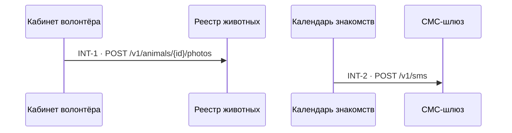

# Схема взаимодействий — ADP-41

> Проекция INT-карточек `technical_specification.md`, по стрелке на звено границы; порядок стрелок —
> по номерам карточек, не по времени. Руками не править: изменились карточки — перерисуй скиллом `interaction-diagram`.

