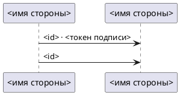
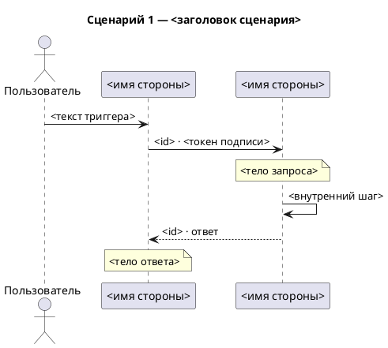

# Формат PlantUML

Файл — `.puml`: блок `@startuml` … `@enduml`; у сценарной — блок на сценарий. Что рисовать и в каком
порядке — файл типа; здесь — как это записать и как проверить записанное.

## Строки

`X` и `Y` — алиасы отправителя и получателя звена (у двустороннего — первой и второй стороны), `U` —
пользователь.

| Что | Строка |
|---|---|
| участник | `participant "<имя стороны>" as S1` |
| пользователь | `actor "Пользователь" as U` |
| запрос от X к Y | `X -> Y : <подпись>` |
| событие от X к Y | `X ->> Y : <подпись>` |
| двустороннее X и Y | `X <-> Y : <подпись>` |
| цепочка | строка на каждое звено, каждая по своему виду |
| действие пользователя | `U -> S1 : <текст триггера>` |
| ответ — обратно своему запросу | на `X -> Y` — `Y --> X : <id> · ответ` |
| пометка над Y | `note over Y : <тело>` |
| внутренний шаг Y | `Y -> Y : <шаг>` |

Алиас — только `S1`, `S2`… по порядку участников (у сценарной — участников сценария, по файлу типа) и
`U` у пользователя; имя стороны — только в строке
`participant`. В строках-комментариях `'` обратных кавычек нет: слова входа пиши без них.

## Короткая → `interaction_diagram.puml`

## Сценарная → `interaction_scenarios.puml`

Блок `@startuml` … `@enduml` на сценарий.

## Как заполнять скелет

Скелет — форма, а не пример: `<…>` заменяются значениями, строк ровно столько, сколько участников и
звеньев (у сценарной — ещё запросов, ответов, пометок и шагов), каждая — по таблице «Строки». Кроме
шапки, `title`, `actor`, `participant`, стрелок и пометок ничего не пиши.

- `<KEY>`, `<пункты источника>` — из раздела «Слова» файла входа.
- `<порядок>`, `<источник сценариев>`, `<заголовок сценария>` — из раздела «Шапка» файла типа.
- `<имя стороны>`, `<id>`, `<токен подписи>`, тела, текст триггера — по файлу входа; шаги — со слов
  аналитика.

## Самопроверка записи

1. У каждого участника алиас `S<n>` по порядку участников (у сценарной — участников сценария), у
   пользователя `U`; имя стороны — только в
   строке `participant`.
2. `<…>` из скелета не осталось.
