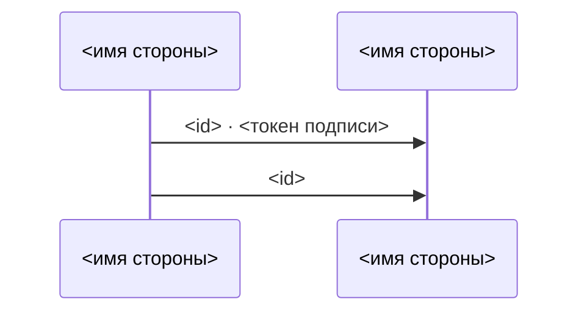
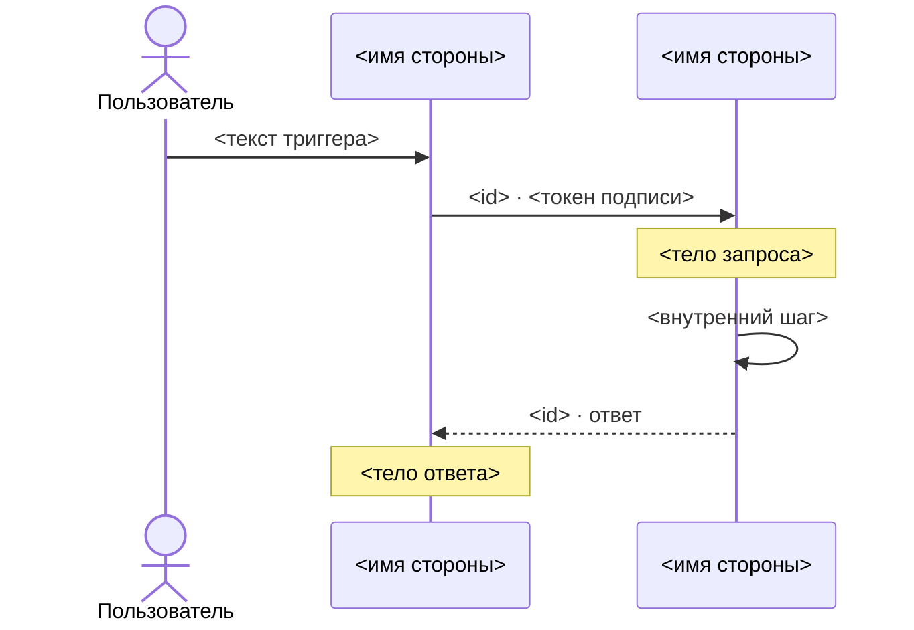
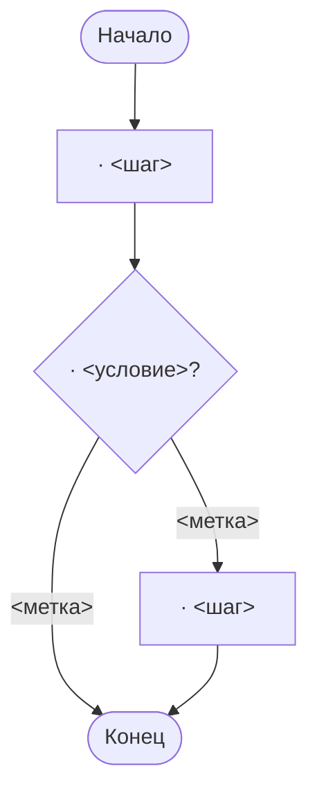

# Формат Mermaid

Файл — `.md`: заголовок, шапка и блок `mermaid`; у сценарной — раздел и блок на сценарий. Что рисовать и
в каком порядке — файл типа; здесь — как это записать и как проверить записанное.

## Строки

`X` и `Y` — алиасы отправителя и получателя звена (у двустороннего — первой и второй стороны), `U` —
пользователь.

| Что | Строка |
|---|---|
| участник | `participant S1 as <имя стороны>` |
| пользователь | `actor U as Пользователь` |
| запрос от X к Y | `X->>Y: <подпись>` |
| событие от X к Y | `X-)Y: <подпись>` |
| двустороннее X и Y | `X<<->>Y: <подпись>` |
| цепочка | строка на каждое звено, каждая по своему виду |
| действие пользователя | `U->>S1: <текст триггера>` |
| ответ — обратно своему запросу | на `X->>Y` — `Y-->>X: <id> · ответ` |
| пометка над Y | `Note over Y: <тело>` |
| внутренний шаг Y | `Y->>Y: <шаг>` |

Mermaid ломается молча, поэтому два правила без исключений: алиас — только `S1`, `S2`… по порядку
участников (у сценарной — участников сценария, по файлу типа) и `U` у пользователя (дефис, пробел или
кириллица в алиасе рвут схему; имя стороны идёт после `as`); `;` и `#` в подписях, пометках и тексте
триггера замени на `#59;` и `#35;`.

## Короткая → `interaction_diagram.md`

````markdown
# Схема взаимодействий — <KEY>

> Проекция <пункты источника>, по стрелке на звено границы; порядок стрелок —
> <порядок>. Руками не править: изменились <пункты> — перерисуй скиллом `interaction-diagram`.


````

## Сценарная → `interaction_scenarios.md`

Раздел и блок `mermaid` на сценарий.

````markdown
# Сценарии взаимодействий — <KEY>

> Проекция <пункты источника> <источник сценариев>. Руками не править:
> изменились <пункты> — перерисуй скиллом `interaction-diagram`.

## Сценарий 1 — <заголовок сценария>


````

## Путь пользователя → `user_flow.md`

Блок `flowchart TB`: сначала все узлы, потом все стрелки.

| Что | Строка |
|---|---|
| начало | `N0(["Начало"])` |
| шаг | `N1["<id> · <шаг>"]` |
| развилка | `N2{"<id> · <условие>?"}` |
| конец | `NE(["Конец"])` — один на схему, к нему идут все концы |
| следующий шаг | `N1 --> N2` |
| ветка | `N2 -- <метка> --> N3` |
| возврат | `N5 --> N3` — стрелка к прежнему шагу |

Узлы — только `N0`, `N1`… по порядку появления и `NE` (дефис или кириллица в имени узла рвут схему);
текст узла — только в кавычках; `"` в тексте замени на `#quot;`, `#` — на `#35;`. Ветка без продолжения —
у её последнего шага стрелки дальше нет.

````markdown
# Путь пользователя — <KEY>

> Проекция <пункты источника>; порядок — <порядок>. Руками не править:
> изменились <пункты> — перерисуй скиллом `interaction-diagram`.


````

## Как заполнять скелет

Скелет — форма, а не пример: `<…>` заменяются значениями, строк ровно столько, сколько участников и
звеньев (у сценарной — ещё запросов, ответов, пометок и шагов; у пути — узлов и стрелок), каждая — по
таблице «Строки» (у пути — по своей таблице). Кроме шапки, заголовков, `actor`, `participant`, узлов,
стрелок и пометок ничего не пиши.

- `<KEY>`, `<пункты источника>`, `<пункты>` — из раздела «Слова» файла входа.
- `<порядок>`, `<источник сценариев>`, `<заголовок сценария>` — из раздела «Шапка» файла типа.
- `<имя стороны>`, `<id>`, `<токен подписи>`, тела, текст триггера — по файлу входа; внутренние шаги
  сценарной — со слов аналитика.
- `<шаг>`, `<условие>`, `<метка>` пути — по файлу входа и ответам аналитика.

## Самопроверка записи

1. У каждого участника алиас `S<n>` по порядку участников (у сценарной — участников сценария), у
   пользователя `U`; имя стороны — только в строке `participant`.
2. `;` и `#` в подписях, пометках и тексте триггера заменены на `#59;` и `#35;`.
3. `<…>` из скелета не осталось.
4. Путь: узлы — `N0`, `N1`… и `NE`, текст в кавычках, `"` и `#` заменены; каждая стрелка ведёт к узлу,
   который объявлен.
