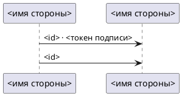
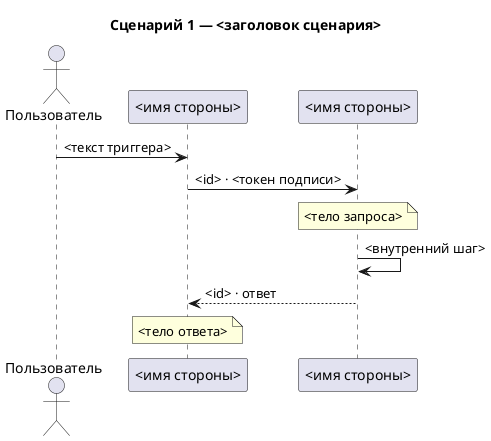
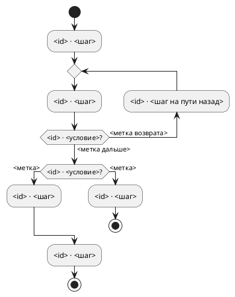

# Формат PlantUML

Файл — `.puml`: блок `@startuml` … `@enduml`; у сценарной — блок на сценарий. Что рисовать и в каком
порядке — файл типа; здесь — как это записать и как проверить записанное.

## Строки

`X` и `Y` — алиасы отправителя и получателя звена (у двустороннего — первой и второй стороны), `U` —
пользователь.

| Что | Строка |
|---|---|
| участник | `participant "<имя стороны>" as S1` |
| пользователь | `actor "Пользователь" as U` |
| запрос от X к Y | `X -> Y : <подпись>` |
| событие от X к Y | `X ->> Y : <подпись>` |
| двустороннее X и Y | `X <-> Y : <подпись>` |
| цепочка | строка на каждое звено, каждая по своему виду |
| действие пользователя | `U -> S1 : <текст триггера>` |
| ответ — обратно своему запросу | на `X -> Y` — `Y --> X : <id> · ответ` |
| пометка над Y | `note over Y : <тело>` |
| внутренний шаг Y | `Y -> Y : <шаг>` |

Алиас — только `S1`, `S2`… по порядку участников (у сценарной — участников сценария, по файлу типа) и
`U` у пользователя; имя стороны — только в строке `participant`. В строках-комментариях `'` обратных
кавычек нет: слова входа пиши без них.

## Короткая → `interaction_diagram.puml`

## Сценарная → `interaction_scenarios.puml`

Блок `@startuml` … `@enduml` на сценарий.

## Путь пользователя → `user_flow.puml`

Activity-диаграмма — структурная: в ней есть только `if … endif` и `repeat … repeat while`, произвольной
стрелки нет.

| Что | Строка |
|---|---|
| начало | `start` |
| шаг | `:<id> · <шаг>;` |
| развилка | `if (<id> · <условие>?) then (<метка>)` … `else (<метка>)` … `endif`; описана одна ветка — без `else`: PlantUML нарисует обход к `endif` — назови это в строке «упрощено» |
| ветки сходятся | после `endif` — общее продолжение: следующий шаг пути |
| конец | `stop` — в конце пути и в конце ветки, которая кончается |
| ветка без продолжения | `detach` после её последнего шага |
| возврат | развилка, от которой возврат, пишется не `if`, а `repeat while` на её месте: `repeat` — перед шагом, к которому возврат; шаг на пути назад (если есть) — `backward:<id> · <шаг на пути назад>;`; затем `repeat while (<id> · <условие>?) is (<метка возврата>) not (<метка дальше>)` |

Граф не ложится в эту структуру (возврат через другую развилку, ветки крест-накрест) — упрости так, чтобы
все шаги остались на схеме, и назови, что упрощено, в строке отчёта «упрощено» (файл типа). `;` внутри
текста шага замени на `,`: `;` закрывает шаг.

## Как заполнять скелет

Скелет — форма, а не пример: `<…>` заменяются значениями, строк ровно столько, сколько участников и
звеньев (у сценарной — ещё запросов, ответов, пометок и шагов; у пути — шагов, развилок и возвратов),
каждая — по таблице «Строки» (у пути — по своей таблице). Кроме шапки, `title`, `actor`, `participant`,
стрелок, пометок, шагов и строк таблицы пути (`start`, `stop`, `detach`, `if`/`else`/`endif`,
`repeat`/`backward`/`repeat while`) ничего не пиши.

- `<KEY>`, `<пункты источника>` — из раздела «Слова» файла входа.
- `<порядок>`, `<источник сценариев>`, `<заголовок сценария>` — из раздела «Шапка» файла типа.
- `<имя стороны>`, `<id>`, `<токен подписи>`, тела, текст триггера — по файлу входа; внутренние шаги
  сценарной — со слов аналитика.
- `<шаг>`, `<условие>`, `<метка>` пути — по файлу входа и ответам аналитика.

## Самопроверка записи

1. У каждого участника алиас `S<n>` по порядку участников (у сценарной — участников сценария), у
   пользователя `U`; имя стороны — только в строке `participant`.
2. `<…>` из скелета не осталось.
3. Путь: у каждого `if` — свой `endif`, у каждого `repeat` — свой `repeat while`; в тексте шагов `;` —
   только в конце.
